# Markdown Rendering Benchmark

This document tests standard Markdown, GitHub-flavored Markdown, and common extensions. Unsupported features may appear as literal text. Mermaid rendering depends on the renderer's support and version.

## 1. Headings

# Heading level 1
## Heading level 2
### Heading level 3
#### Heading level 4
##### Heading level 5
###### Heading level 6

Setext heading level 1
======================

Setext heading level 2
----------------------

## 2. Paragraphs and line breaks

This is the first paragraph. It contains several sentences to test normal text rendering, spacing, and wrapping.

This is the second paragraph.

This line has a soft break.
This is the next source line in the same paragraph.

This line ends with two spaces for a hard break.  
This should appear on the next line.

This line ends with a backslash for a hard break.\
This should also appear on the next line.

This line uses an HTML break.<br>
This should appear on the next line if HTML is supported.

## 3. Text formatting

*Italic with asterisks*

_Italic with underscores_

**Bold with asterisks**

__Bold with underscores__

***Bold and italic together***

___Bold and italic with underscores___

**Bold containing *italic text* inside**

*Italic containing **bold text** inside*

~~Strikethrough~~

~~**Bold strikethrough**~~

~~*Italic strikethrough*~~

**Bold**, *italic*, ~~deleted~~, and `inline code` in one sentence.

==Highlighted text==

++Inserted text++

H~2~O using a subscript extension.

x^2^ using a superscript extension.

## 4. Escaping and literal characters

\*This should not be italic\*

\*\*This should not be bold\*\*

\# This should not be a heading

\[This should not be a link\]

\> This should not be a blockquote

\- This should not be a list item

1\. This should not be an ordered list item

Literal backslash: \\

Escaped punctuation: \` \* \_ \{ \} \[ \] \< \> \( \) \# \+ \- \. \! \|

Underscores inside a word: some_variable_name

HTML entities: &amp; &lt; &gt; &quot; &apos; &copy; &reg; &trade; &nbsp;

Numeric entities: &#169; &#x1F680;

## 5. Horizontal rules

Three asterisks:

***

Three hyphens:

---

Three underscores:

___

Spaced asterisks:

* * *

## 6. Blockquotes

> A single-line blockquote.

> A blockquote spanning multiple source lines.
> This line belongs to the same paragraph.

> First paragraph inside a blockquote.
>
> Second paragraph inside the same blockquote.

> Outer blockquote.
>
> > Nested blockquote.
> >
> > > Third-level blockquote.

> ### Heading inside a blockquote
>
> **Bold**, *italic*, and `code` inside a blockquote.
>
> - First list item
> - Second list item
>
> ```python
> print("Code inside a blockquote")
> ```

## 7. Unordered lists

- Hyphen item one
- Hyphen item two
- Hyphen item three

* Asterisk item one
* Asterisk item two

+ Plus item one
+ Plus item two

### Nested lists

- Parent item
  - Child item
    - Grandchild item
  - Another child
- Another parent

### Loose list with paragraphs

- First item.

  A second paragraph belonging to the first item.

- Second item.

  A second paragraph belonging to the second item.

### List with other block elements

- Item containing a quote:

  > A quotation inside a list item.

- Item containing code:

  ```javascript
  const message = "Code inside a list";
  console.log(message);
  ```

- Item containing a nested ordered list:
  1. First step
  2. Second step

## 8. Ordered lists

1. First item
2. Second item
3. Third item

### List starting at a different number

7. Seventh item
8. Eighth item
9. Ninth item

### Automatic numbering

1. First item
1. Second item
1. Third item

### Parenthesis delimiters

1) First item
2) Second item
3) Third item

### Mixed nested lists

1. First ordered item
   - Unordered child
   - Another unordered child
2. Second ordered item
   1. Ordered child
   2. Another ordered child

## 9. Task lists

- [ ] Unchecked task
- [x] Completed task
- [X] Completed task with uppercase X
- [ ] Task with **bold text** and a [link](https://example.com)
- [ ] Parent task
  - [x] Completed subtask
  - [ ] Pending subtask

## 10. Inline code

Use `console.log("Hello");` to print a message.

Code containing a backtick: ``const delimiter = "`";``

Code containing Markdown: `**not bold** and [not a link](https://example.com)`

Code containing HTML: `<div class="example">Hello</div>`

A literal pipe in inline code: `a | b`

## 11. Code blocks

### Fenced block without a language

```
Plain code block.
**This should remain literal.**
<em>This should remain literal.</em>
```

### JavaScript syntax highlighting

```javascript
// A comment
const user = {
  name: "Ada",
  active: true,
  score: 42,
};

function greet({ name }) {
  return `Hello, ${name}!`;
}

console.log(greet(user));
```

### Python syntax highlighting

```python
from dataclasses import dataclass

@dataclass
class Point:
    x: float
    y: float

def distance_squared(point: Point) -> float:
    """Return the squared distance from the origin."""
    return point.x ** 2 + point.y ** 2

print(distance_squared(Point(3, 4)))
```

### JSON syntax highlighting

```json
{
  "name": "Markdown benchmark",
  "enabled": true,
  "count": 3,
  "items": ["alpha", "beta", "gamma"],
  "optional": null
}
```

### Diff highlighting

```diff
- const enabled = false;
+ const enabled = true;
  console.log(enabled);
```

### Shell highlighting

```bash
printf '%s\n' "Hello, Markdown"
```

### Tilde fence

~~~text
This block uses tilde fences instead of backticks.
~~~

### Longer fence containing shorter fences

````markdown
```javascript
console.log("A fenced block inside another fenced block");
```
````

### Indented code block

    This code block is indented by four spaces.
    Markdown **formatting** should remain literal.
    Second line of indented code.

## 12. Links

[Inline link](https://example.com)

[Link with a title](https://example.com "Example website")

[**Bold link text**](https://example.com)

[*Italic link text*](https://example.com)

[Link containing `inline code`](https://example.com)

[Email link](mailto:hello@example.com)

[Relative link](./example.md)

[Fragment link](#markdown-rendering-benchmark)

[Link with escaped parentheses](https://example.com/path\(example\))

[Full reference link][example-site]

[Collapsed reference link][]

[Shortcut reference link]

### Autolinks

<https://example.com>

<hello@example.com>

### GitHub-flavored bare links

https://example.com

www.example.com

hello@example.com

## 13. Images


![Reference-style image][benchmark-image]

[](https://example.com)

## 14. Tables

| Default alignment | Left aligned | Center aligned | Right aligned |
| --- | :--- | :---: | ---: |
| Plain text | Left | Center | 123 |
| **Bold** | *Italic* | ~~Deleted~~ | 4.56 |
| `Inline code` | [Link](https://example.com) | ✅ | -789 |
| Empty cell follows | | Present | 0 |
| Escaped pipe: \| | Code pipe: `a \| b` | A<br>B | 1,000 |

### Compact table without outer pipes

Name | Type | Value
--- | --- | ---:
Alpha | String | 10
Beta | Number | 20

### Table inside a blockquote

> | Item | Status |
> | --- | --- |
> | Quoted table | Works if supported |
> | Second row | Complete |

## 15. Footnotes

This sentence has a footnote.[^simple]

This sentence has a longer footnote.[^long]

The same footnote can be referenced again.[^simple]

## 16. Definition lists

Markdown
: A lightweight markup language.

Term with multiple definitions
: First definition.
: Second definition.

Complex term
: A definition containing **bold text** and `code`.

  A second paragraph belonging to the definition.

## 17. GitHub-style alerts

> [!NOTE]
> Supplemental information.

> [!TIP]
> A useful suggestion.

> [!IMPORTANT]
> Essential information.

> [!WARNING]
> Something requiring care.

> [!CAUTION]
> A possible undesirable consequence.

## 18. Mathematics

### Inline dollar delimiters

The Pythagorean theorem is $a^2 + b^2 = c^2$.

Euler's identity is $e^{i\pi} + 1 = 0$.

### Display dollar delimiters

$$
\int_0^1 x^2\,dx = \frac{1}{3}
$$

### Aligned equations

$$
\begin{aligned}
f(x) &= x^2 + 2x + 1 \\
     &= (x + 1)^2
\end{aligned}
$$

### Matrix

$$
A = \begin{bmatrix}
1 & 2 \\
3 & 4
\end{bmatrix}
$$

### Piecewise expression

$$
|x| =
\begin{cases}
x, & x \ge 0 \\
-x, & x < 0
\end{cases}
$$

### Alternative LaTeX delimiters

Inline: \( E = mc^2 \)

Display:

\[
\sum_{k=1}^{n} k = \frac{n(n+1)}{2}
\]

## 19. Mermaid charts and diagrams

### Basic flowchart

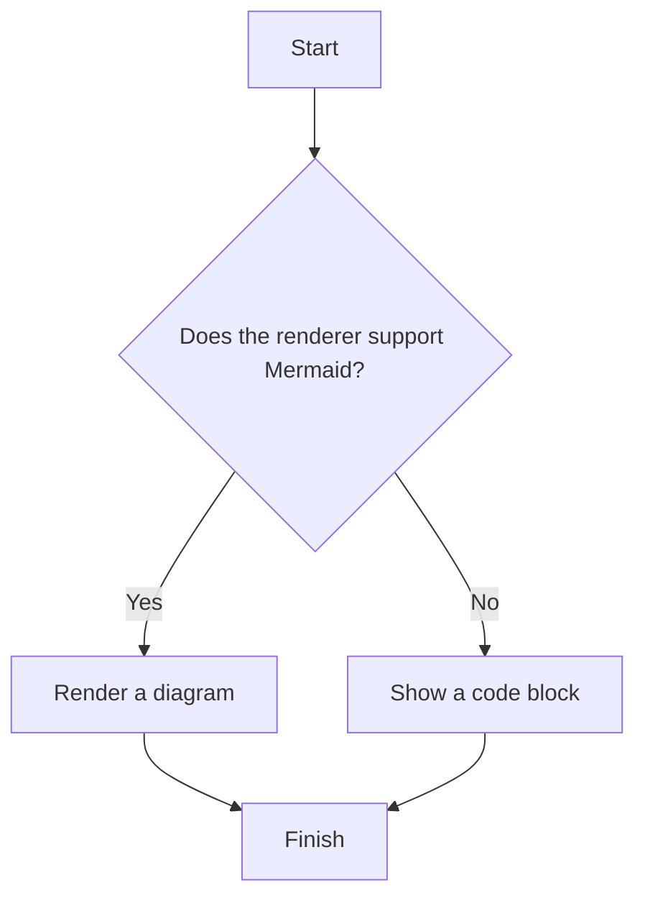

### Basic sequence diagram

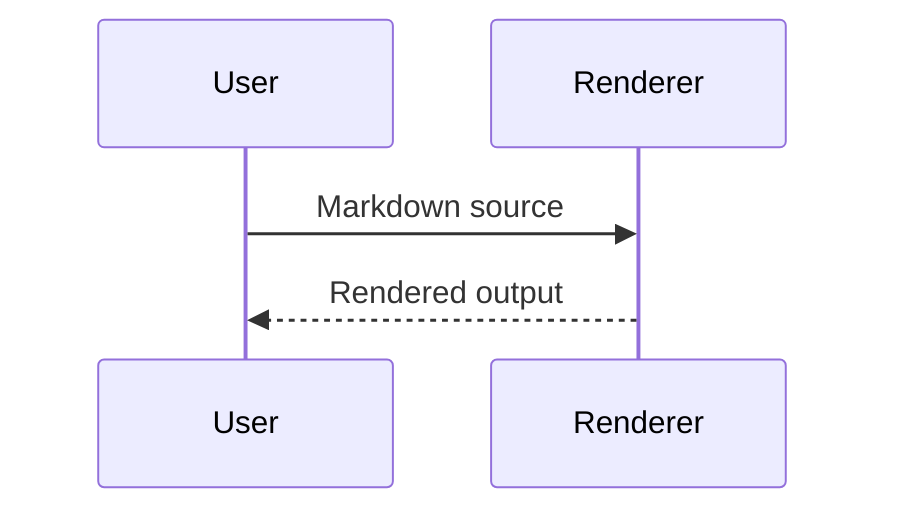

### Flowchart: decisions and node shapes

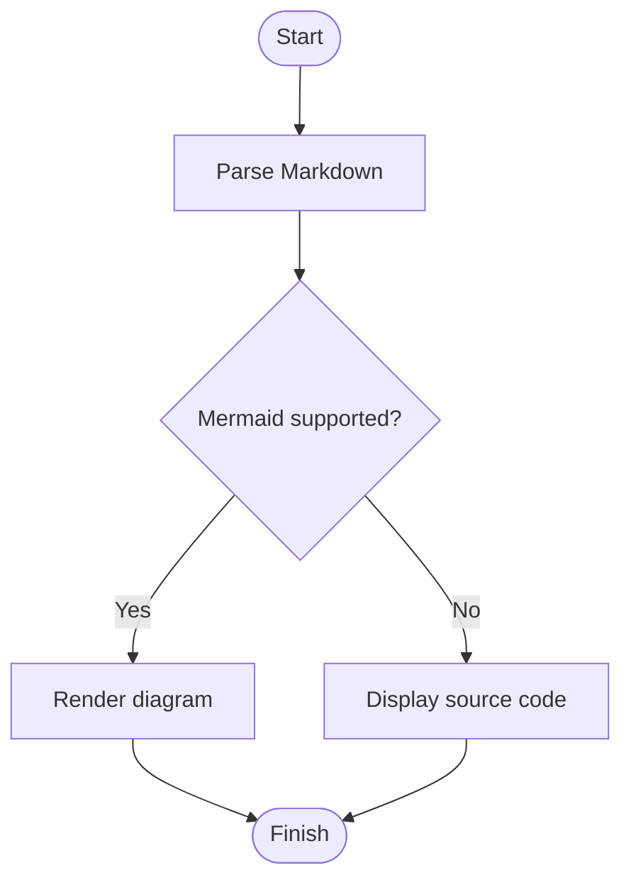

### Flowchart: groups, horizontal layout, and styling

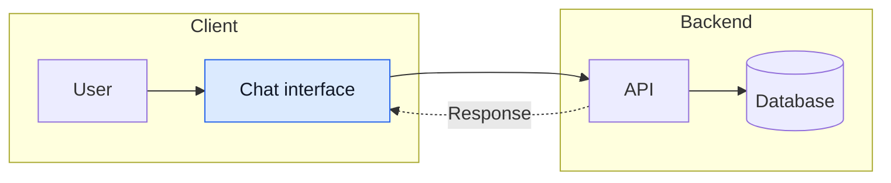

### Sequence diagram: participants, conditions, and notes

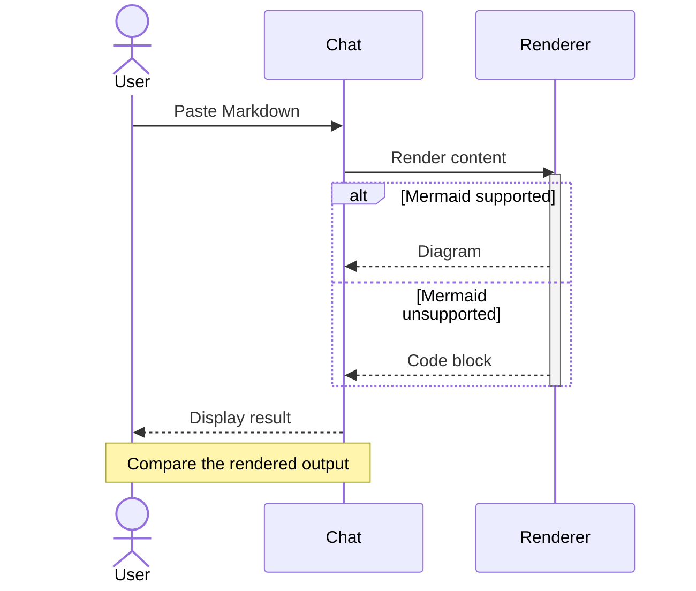

### Class diagram: attributes, methods, and relationships

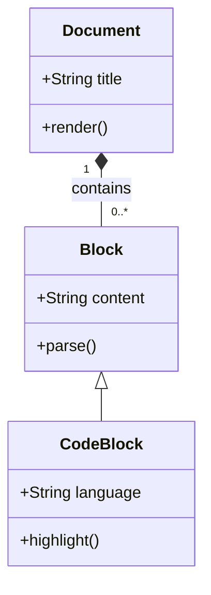

### State diagram: transitions and terminal states

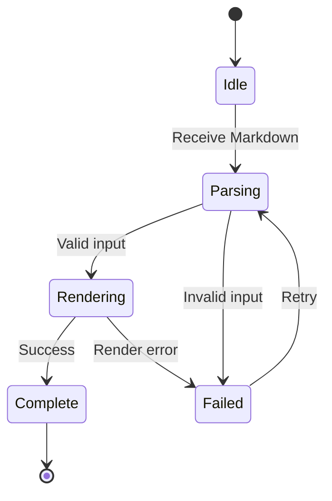

### Entity relationship diagram: cardinality and fields

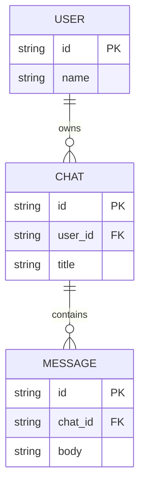

### Gantt chart: tasks, dependencies, and milestones

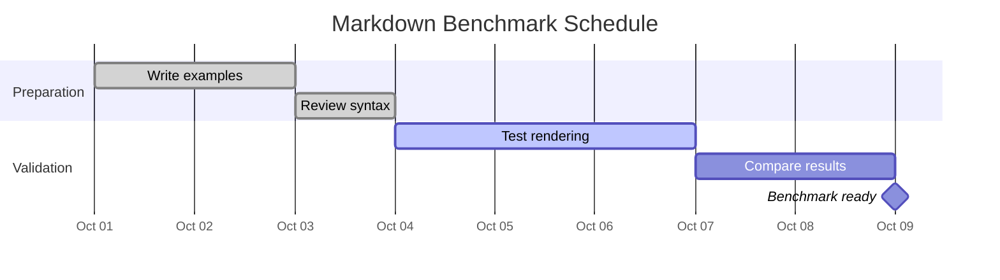

### Pie chart: labels, legend, and values

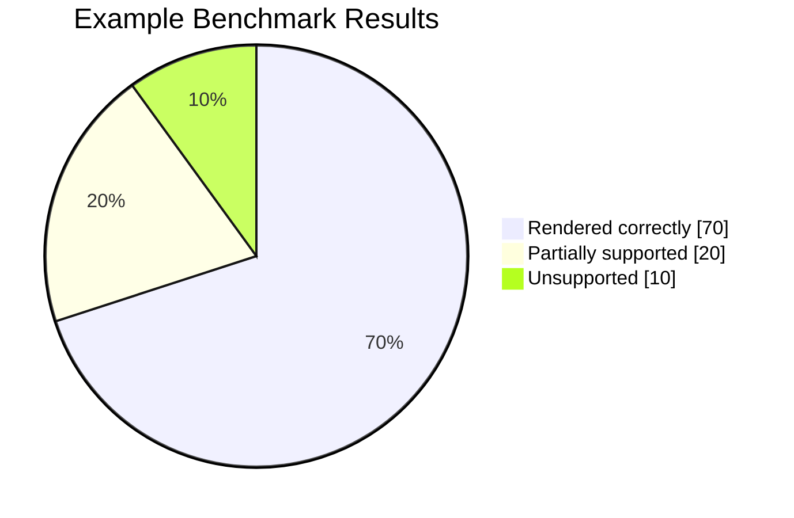

### Mind map: hierarchy and branching

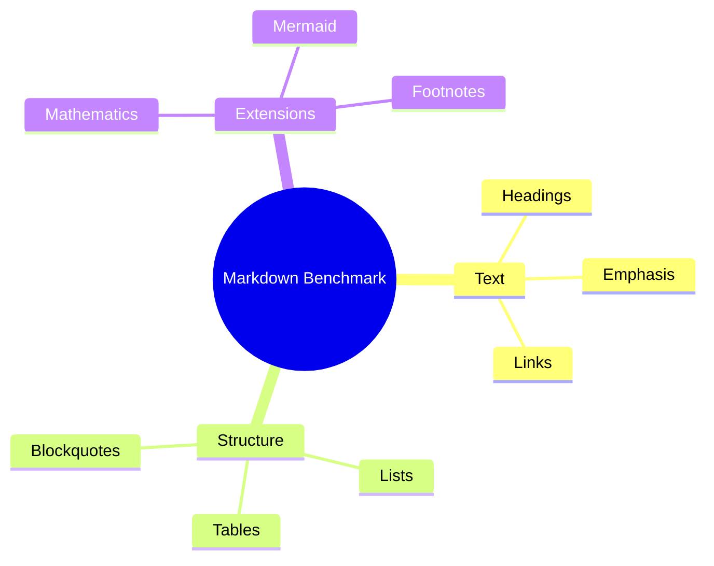

## 20. Raw HTML

<strong>HTML bold</strong>

<em>HTML italic</em>

<del>HTML deletion</del>

<ins>HTML insertion</ins>

<mark>HTML highlight</mark>

H<sub>2</sub>O and x<sup>2</sup>

Press <kbd>Ctrl</kbd> + <kbd>C</kbd>.

<abbr title="HyperText Markup Language">HTML</abbr>

<small>Small text.</small>

<span style="color: purple;">Inline color, if styles are permitted.</span>

<a id="custom-anchor"></a>

[Link to the custom HTML anchor](#custom-anchor)

<!-- This HTML comment should be hidden when HTML is interpreted. -->

### Collapsible details

<details>
<summary>Click to expand</summary>

Text inside the collapsible section.

- First item
- Second item

**Bold Markdown inside HTML**, if the renderer permits it.

</details>

### HTML table

<table>
  <thead>
    <tr>
      <th>Feature</th>
      <th>Value</th>
    </tr>
  </thead>
  <tbody>
    <tr>
      <td colspan="2">A cell spanning two columns</td>
    </tr>
    <tr>
      <td>HTML table</td>
      <td>Supported or sanitized</td>
    </tr>
  </tbody>
</table>

## 21. Additional extension syntax

### Heading with explicit attributes {#explicit-heading .example-class}

[Link to an explicit heading ID](#explicit-heading)

### Fenced div

::: {.example}
A fenced container with **formatted content**.
:::

### Attribute on inline content

[Text with attributes]{.example #inline-example}

### Attribute on an image

{width=160 height=60}

### Abbreviations

HTML and CSS may receive expanded tooltips in renderers supporting abbreviation definitions.

### Citation syntax

A citation with an external bibliography: [@doe2024].

A narrative citation: @doe2024.

Multiple citations: [@doe2024; @smith2025, pp. 12–14].

### Emoji shortcodes

:smile: :rocket: :warning: :white_check_mark:

### Direct Unicode emoji

😀 🚀 ⚠️ ✅ ❤️ 👩🏽‍💻 🏳️‍🌈

## 22. Unicode and typography

Accents: café, naïve, résumé, Ångström.

Turkish: İstanbul, ı, İ, ş, ç, ğ, ö, ü.

Greek: α β γ Δ Ω.

Chinese: 你好，世界。

Japanese: こんにちは世界。

Korean: 안녕하세요 세계.

Arabic: مرحبًا بالعالم

Hebrew: שלום עולם

Punctuation: “double quotes”, ‘single quotes’, an en dash – and an em dash —.

Symbols: © ® ™ ° ± × ÷ → ← ↔ ≤ ≥ ≠ ∞.

## 23. Wrapping and edge cases

A long sentence to test wrapping: The quick brown fox jumps over the lazy dog, while the Markdown renderer lays out a long paragraph across whatever width the surrounding interface provides, maintaining readable spacing and preserving inline **bold**, *italic*, and `code` formatting.

Long unbroken token:

abcdefghijklmnopqrstuvwxyzABCDEFGHIJKLMNOPQRSTUVWXYZ0123456789abcdefghijklmnopqrstuvwxyzABCDEFGHIJKLMNOPQRSTUVWXYZ0123456789

Long inline code:

`abcdefghijklmnopqrstuvwxyzABCDEFGHIJKLMNOPQRSTUVWXYZ0123456789abcdefghijklmnopqrstuvwxyzABCDEFGHIJKLMNOPQRSTUVWXYZ0123456789`

Formatting adjacent to punctuation: (**bold**), [link](https://example.com), and *italic*.

Adjacent formatting: **bold***italic*`code`~~deleted~~

Empty inline HTML element: <span></span>

## 24. Reference definitions

[example-site]: https://example.com "Reference link title"
[Collapsed reference link]: https://example.com/collapsed
[Shortcut reference link]: https://example.com/shortcut
[benchmark-image]: https://placehold.co/240x80/png?text=Reference+Image "Reference image title"

[^simple]: A short footnote with **bold text**.

[^long]: The first paragraph of a longer footnote.

    A second paragraph inside the footnote.

    - A list item inside the footnote.
    - Another list item.

    ```text
    A code block inside the footnote.
    ```

*[HTML]: HyperText Markup Language
*[CSS]: Cascading Style Sheets
